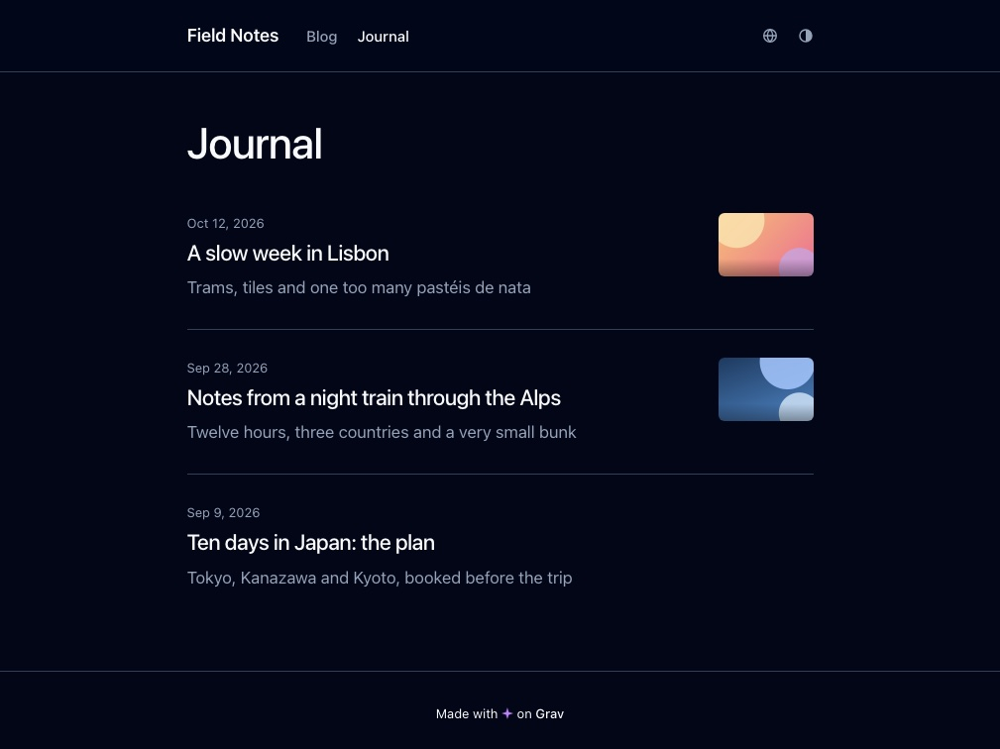

# bcn

A calm, readable blog theme for [Grav](https://getgrav.org): Blades CSS base, light/dark/auto modes, an accessible
palette, and a header with a real menu. Named after BCN, the airport its author flies home to.



## Features

- Header with the site name and menu on the left, language and theme as two small icon menus on the right; a ☰ panel
  on phones. Keyboard friendly: Escape closes a menu and returns focus.
- Light, dark and auto (follow the OS) modes, remembered per visitor.
- Five accent colours, each with a matching favicon.
- Blog list with the date first and a thumbnail: the post's frontmatter `image`, else the first local image its body
  shows.
- Titles never break inside a hyphenated word or a numeric range ("New-York", "24–29").
- Multi-language aware: a post shown in a fallback language gets a badge in the list and a one-line note above the text.
- Author byline and bio from Grav user accounts, and an optional notice on posts drafted by an AI agent account.
- No build step: plain Twig, CSS and one small JavaScript file. Blades CSS ships in `css/vendor/`.

## Supported page templates

- `blog`: a list of the page's children
- `item`: a post
- `default`: a plain page
- `error`: the 404 page

## Installation

### Manual

1. Download the zip of the [latest release](https://github.com/malyushkin/grav-theme-bcn/releases/latest).
2. Unzip it into `user/themes/` of your Grav site and rename the folder to `bcn`.
3. Set `pages.theme: bcn` in `user/config/system.yaml`, or pick the theme in the admin.

### GPM

Coming later: the theme is not in the Grav package catalog yet.

## Updating

Replace the `user/themes/bcn` folder with the new release, unzipped and renamed the same way. Your options live in
`user/config/themes/bcn.yaml` and are not touched.

## Options

Theme options live under Themes → bcn in the admin:

- **Theme:** `theme_mode` (auto/light/dark), `accent_color`
- **AI Authorship:** `ai_notice_enabled`, `ai_notice_authors`
- **Header:** `header_fixed`, `header_animated`
- **Footer:** `sticky_footer`
- **Blog:** `blog_page`
- **Icons:** `fontawesome_enabled`

`accent_color` is picked from colour squares drawn by `admin-next/fields/accent-swatch.js`, an Admin 2 custom field.
The classic admin does not know that field type, so there the option is set in `user/config/themes/bcn.yaml` by hand.

`fontawesome_enabled` loads Font Awesome 7 for icons inside post content. The header icons are inline SVG and do not
need it.

The AI notice ships off: `ai_notice_enabled: 0` and an empty `ai_notice_authors`. Once both are set, a post whose
`author` is one of those accounts gets a line at the end saying an AI assistant drafted it. The account picker comes
from the `api` plugin's Admin 2 fields; on the classic admin, set the list in `user/config/themes/bcn.yaml`.

## Post authors

A post's `author` in the frontmatter is matched against a Grav user account. The byline shows the account's
`fullname` and `title`, and the block at the end of the post adds its `bio`. Without an account, set the same values
per page:

```yaml
author: jane
author_title: 'Data engineer'
author_bio: 'One or two sentences, shown under the name at the end of the post.'
```

The avatar is the account's own photo, uploaded through the admin and resized by Grav. Without one, the byline has no
image.

## Favicon

The favicon follows `accent_color`: `images/favicon-<accent>.svg` and `images/favicon-<accent>-180.png` for each of the
five presets. The SVG covers browsers; the PNG covers iOS, which does not accept SVG for `apple-touch-icon`. The colour
is baked into each file, because an icon in `<link rel="icon">` cannot see the page's CSS variables.

## License

MIT, see [LICENSE](LICENSE). Bundled [Blades CSS](https://blades.ninja/) (a Pico CSS fork) is MIT as well.
